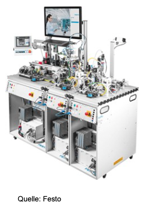
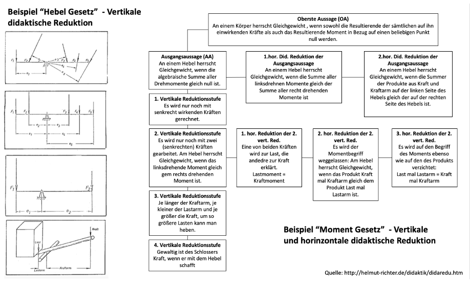

<!--
author:    Hannes Tegelbeckers
email:     hannes.tegelbeckers@ovgu.de
version:   1.0.0
language:  de
narrator:  Deutsch Female
mode:      Presentation
classroom: enable

title:     T1 – Lehren und Lernen in ingenieurpädagogischen Laboren
comment:   Gruppen-Input T1 im Ingenieurpädagogischen Labor (WiSe 2026/27, Sitzung 4 am 03.11.2026). Folgt Folie für Folie der Präsentation „Lehren und Lernen in ingenieurpädagogischen Laboren“ (Ingenieurpädagogisches Labor, Dozent: M. Robra; Fassung 2023): technische Lernsysteme, Vor- und Nachteile, Methoden, Experimente, Prüfverfahren, Planungsebenen, didaktische Reduktion, Medien, Angebot-Nutzungs-Modell und didaktischer Raum.
tags:      Ingenieurpädagogisches Labor, Lehren und Lernen, technische Lernsysteme, Experiment, Prüfverfahren, didaktische Reduktion, Medien
-->

<!--
QUELLENTREUE - Hinweise fuer Bearbeitende. Bitte in diesem Kommentar keine runden Klammern verwenden, LiaScript zeigt solche Kommentare sonst als Text an.
- Grundlage: Presentation_IngLab_2023_Lehren_Lernen_ingped_Labor_V_01.pdf mit 23 Seiten.
  Gliederung, Reihenfolge und Wortlaut der Folien 1 bis 20 sind uebernommen; jede Folie traegt einen Marker src: Folie N.
- Folie 5 hat im Original keinen Titel; die Ueberschrift stammt aus dem Folientext.
- Folie 13 traegt im PDF nur den verdeckten Titel Mundus in gutta; ihr Inhalt ist die Abbildung Ebenen und Formen der didaktischen Reduktion.
- Folie 14 ist auf zwei Folien verteilt: Abbildung und Lesefassung. Die Lesefassung ist der Text der Original-Abbildung aus Hebelgesetzt Abbildung Neu.pptx, keine Ergaenzung.
- Folien 21 bis 23 mit der Literaturliste gehoerten zu einem Arbeitsschutz-Foliensatz. Die Quellenfolie nennt deshalb nur die auf den Folien 2 bis 20
  zitierten Quellen plus Herzig und Assmann 2009 von Folie 23. Fehlende bibliografische Angaben sind NICHT ergaenzt.
- Ergaenzungen, die nicht auf den Originalfolien stehen: Kurzchecks mit Antworten nur aus den Folien, Video-Tipps. Beide sind sichtbar gekennzeichnet.
- Korrigierte offensichtliche Tippfehler im Folientext, keine Zitate: Fachkenntnissen zu Fachkenntnisse; des System zu des Systems;
  gesundheitlicher zu gesundheitlichen; maßstabsgetreu Abbildung zu maßstabsgetreue Abbildung; Unterrichtplanung zu Unterrichtsplanung;
  Analgen zu Anlagen; strenge kontrollierte zu streng kontrollierte; Quas-Experimente zu Quasi-Experimente; Angehenden Facharbeiter zu Angehende Facharbeiter;
  Umwandelung zu Umwandlung; Darstellungsfomen zu Darstellungsformen; Realistischen Ambiente zu realistischem Ambiente; Learning by desing zu Learning by design;
  Medienunterstütze zu Medienunterstützte; Hebel-Abbildung: linksdrehnen, recht drehenden, Summer, andedre, gem zu linksdrehenden, rechtsdrehenden, Summe, andere, dem.
  Das Zitat auf Folie 12 mit daß bleibt in alter Rechtschreibung.
-->

# Lehren und Lernen in ingenieurpädagogischen Laboren

<!-- src: Folie 1 -->

**Gruppen-Input T1** · Ingenieurpädagogisches Labor · WiSe 2026/27 · 03.11.2026

Otto-von-Guericke-Universität Magdeburg · Fakultät für Humanwissenschaften

<small>Grundlage: Präsentation „Lehren und Lernen in ingenieurpädagogischen Laboren“, Ingenieurpädagogisches Labor (Dozent: M. Robra, WiSe 20/21; Fassung 2023). Kurzchecks und Video-Tipps sind Ergänzungen und als solche gekennzeichnet.</small>

                --{{0}}--
Willkommen zum Gruppen-Input „Lehren und Lernen in ingenieurpädagogischen Laboren“. Wir gehen der Reihe nach vor: technische Lernsysteme mit ihren Vor- und Nachteilen, die Methoden, in die sie eingebettet werden, das Experiment und das Prüfverfahren, die didaktische Reduktion und zum Schluss die Medien im Lehr-Lernprozess.

## Lernsysteme im Bereich Mechatronik und Automatisierung

<!-- src: Folie 2 -->



                --{{0}}--
Hier sehen Sie ein Lernsystem aus dem Bereich Mechatronik und Automatisierung. Mit solchen Systemen werden Fachkenntnisse, Kompetenzen und die Psychomotorik angesprochen.

                --{{1}}--
Zu den Fachkenntnissen gehören Fachsystematik und Fachbegriffe, die Funktion des Systems und seiner Komponenten, Wirkprinzipien, System- und Prozesszusammenhänge sowie die Bedienung und die Konfiguration eines Systems.

{{1}}
<section>

**Fachkenntnisse**

- Fachsystematik & Fachbegriffe
- Funktion des Systems & Komponenten
- Wirkprinzipien
- Systemzusammenhänge
- Prozesszusammenhänge
- Bedienung eines Systems
- Konfiguration eines Systems

</section>

                --{{2}}--
Fach-, Sozial- und Methodenkompetenz – wie stark sie gefördert werden, ist lernziel- und methodenabhängig.

{{2}}
<section>

**Kompetenzen** – lernziel- und methodenabhängig

- Fachkompetenzen
- Sozialkompetenzen
- Methodenkompetenz

</section>

                --{{3}}--
Die Psychomotorik beziehungsweise Berufsmotorik spielt im schulischen Kontext meist eine untergeordnete Rolle, kann mit solchen Lernsystemen jedoch gefördert werden.

{{3}}
<section>

**Psychomotorik/Berufsmotorik**

- spielt im schulischen Kontext meist eine untergeordnete Rolle, kann jedoch hiermit gefördert werden

</section>

## Vorteile von technischen Lernsystemen

<!-- src: Folie 3 -->

- Anschaulichkeit, Übersichtlichkeit
- Demonstration
- Aktivierung, Motivation, Anregung
- Üben, Wiederholen, Trainieren, Einprägen
- Anwenden
- Transfer

                --{{0}}--
Technische Lernsysteme sind anschaulich und übersichtlich, eignen sich zur Demonstration, aktivieren und motivieren, ermöglichen Üben, Wiederholen, Trainieren und Einprägen und unterstützen das Anwenden und den Transfer.

                --{{1}}--
Aus didaktischer Sicht kommt hinzu: Qualifizierte Lehrkräfte begleiten die Lernprozesse, die Systeme sind verfügbar und schonen Ressourcen, sie bieten Sicherheit, Termindruck und Qualitätszwang fallen weg, sodass Fehler gemacht und Schritte wiederholt werden dürfen. Lehrkräfte können die Systeme didaktisch modifizieren, und die Ausbildungsergebnisse werden überprüfbar und standardisierbar.

{{1}}
<section>

**aus didaktischer Sicht:**

- Qualifizierte Lehrkräfte und Aufsichten begleiten die Lernprozesse
- Verfügbarkeit und Ressourcenschonung
- Sicherheit und Entlastung von gesundheitlichen Arbeitsbedingungen
- Wegfall von Termindruck, Qualitätszwang wird reduziert (Fehler dürfen gemacht werden, Möglichkeiten der Wiederholung)
- Didaktische Modifizierung (Reduktion, bewusstes Herbeiführen von Fehlern)
- Überprüfbarkeit und Standardisierung der Ausbildungsergebnisse

</section>

## Nachteile von technischen Lernsystemen in ingenieurpädagogischen Laboren

<!-- src: Folie 4 -->

- Bezug zur Berufs- und Arbeitswelt ist reduziert
  - Simulation, Modelle
  - nicht maßstabsgetreue Abbildung des Systems (Miniaturisierung)
  - kognitive Transferleistungen erforderlich

                --{{0}}--
Der wichtigste Nachteil: Der Bezug zur Berufs- und Arbeitswelt ist reduziert. Lernsysteme sind Simulationen und Modelle, sie bilden das System nicht maßstabsgetreu ab, und die Lernenden müssen kognitive Transferleistungen erbringen.

                --{{1}}--
Hinzu kommen teils unter- oder überkomplexe Technologien als Ausbildungsmaterial, die schwierigere Einbettung in reale betriebliche Arbeitsprozesse, der Planungsaufwand, die nötige Beherrschung der Technik durch die Lehrkraft sowie Funktionsstörungen und Defekte, die den geplanten Unterrichtsverlauf behindern können.

{{1}}
<section>

- teilweise unter- oder überkomplexe Technologien und Maschinen als Ausbildungsmaterial vorhanden
- Einbettung in reelle betriebliche Arbeitsprozesse schwieriger
- Aufwand der Unterrichtsplanung
- Beherrschung der Technik und Anlagen durch Lehrkraft ist erforderlich
- Funktionsstörungen, Defekte ggf. Fehlerbehebung behindern den planmäßigen Unterrichtsverlauf

</section>

## Kurzcheck 1: Vor- und Nachteile

> [!NOTE] ✍️ Ergänzung
> Nicht Teil der Originalfolien. Alle Antworten stehen auf den Folien 3 und 4.

                --{{0}}--
Ein kurzer Check zu den Vor- und Nachteilen. Alle Antworten finden Sie auf den beiden vorherigen Folien.

**1. Welche Punkte nennt die Folie als Vorteile *aus didaktischer Sicht*?**

- [[X]] Wegfall von Termindruck, Qualitätszwang wird reduziert (Fehler dürfen gemacht werden)
- [[ ]] Einbettung in reelle betriebliche Arbeitsprozesse
- [[X]] Didaktische Modifizierung (Reduktion, bewusstes Herbeiführen von Fehlern)
- [[ ]] maßstabsgetreue Abbildung des Systems
- [[X]] Überprüfbarkeit und Standardisierung der Ausbildungsergebnisse
***
Vorteile aus didaktischer Sicht (Folie 3): Qualifizierte Lehrkräfte und Aufsichten begleiten die Lernprozesse · Verfügbarkeit und Ressourcenschonung · Sicherheit und Entlastung von gesundheitlichen Arbeitsbedingungen · Wegfall von Termindruck, Qualitätszwang wird reduziert (Fehler dürfen gemacht werden, Möglichkeiten der Wiederholung) · Didaktische Modifizierung (Reduktion, bewusstes Herbeiführen von Fehlern) · Überprüfbarkeit und Standardisierung der Ausbildungsergebnisse.

Die beiden anderen Punkte stehen auf Folie 4 als **Nachteile**: Die Einbettung in reelle betriebliche Arbeitsprozesse ist schwieriger, und das System wird *nicht* maßstabsgetreu abgebildet (Miniaturisierung).
***

**2. Warum sind beim Lernen an technischen Lernsystemen kognitive Transferleistungen erforderlich?**

- [(X)] Weil der Bezug zur Berufs- und Arbeitswelt reduziert ist (Simulation, Modelle, Miniaturisierung).
- [( )] Weil Fehler am Lernsystem nicht gemacht werden dürfen.
- [( )] Weil keine qualifizierten Lehrkräfte die Lernprozesse begleiten.
***
Folie 4: „Bezug zur Berufs- und Arbeitswelt ist reduziert – Simulation, Modelle – nicht maßstabsgetreue Abbildung des Systems (Miniaturisierung) – kognitive Transferleistungen erforderlich.“ Die beiden anderen Antworten widersprechen Folie 3: Fehler *dürfen* gemacht werden, und qualifizierte Lehrkräfte begleiten die Lernprozesse.
***

## Methoden der schulischen Berufsbildung

<!-- src: Folie 5 -->

Grundsätzlich werden technische Lernsysteme und Laborarbeiten in Methoden der schulischen Berufsbildung eingebettet.

<u>Eine Auswahl:</u>

- **Analyseaufgabe**
- **Experimente**
- **Technisches Projekt**
- **Problem Based Learning PBL**
- **Praxisaufgabe**
- **Stationslernen**
- **Leittext-Methode**
- **Vier-Stufen-Methode**

                --{{0}}--
Grundsätzlich werden technische Lernsysteme und Laborarbeiten in Methoden der schulischen Berufsbildung eingebettet. Die Folie nennt eine Auswahl: Analyseaufgabe, Experimente, technisches Projekt, Problem Based Learning, Praxisaufgabe, Stationslernen, Leittext-Methode und Vier-Stufen-Methode. Die folgenden Folien vertiefen das Experiment.

## Merkmale eines Experiments

<!-- src: Folie 6 -->

- gezielt und planmäßig hergestellte Experimentalbedingungen
- kontrollierbare Bedingungen
- systematische Variation von Variablen
- systematische Erfassung von Variablen
- Kontrolle von Störvariablen
- Wiederholbarkeit

                --{{0}}--
Ein Experiment hat sechs Merkmale: gezielt und planmäßig hergestellte Experimentalbedingungen, kontrollierbare Bedingungen, die systematische Variation und die systematische Erfassung von Variablen, die Kontrolle von Störvariablen und die Wiederholbarkeit.

                --{{1}}--
Unterschieden werden Labor- und Feldexperiment. Das Laborexperiment arbeitet unter künstlichen, präparierten und streng kontrollierten Bedingungen und isoliert ein Phänomen. Das Feldexperiment findet unter natürlichen, semioffenen Bedingungen statt; Störeinflüsse sind potenziell größer, und ein Phänomen lässt sich schwerer isolieren.

{{1}}
<section>

| Laborexperiment                      | Feldexperiment                        |
| :----------------------------------- | :------------------------------------ |
| künstliche, präparierte Bedingungen  | natürliche, semioffene Bedingungen    |
| streng kontrollierte Bedingungen     | Störeinflüsse potenziell größer       |
| Isolation eines Phänomens            | Isolation eines Phänomens schwieriger |

</section>

<small>Quelle: Straka, Meyer-Siever, Rosendahl: In Handbuch Berufsbildungsforschung. Laborexperimente und Quasi-Experimente. Bertelsmann Verlag 2006</small>

## Experimente nach Erkenntniszielen

<!-- src: Folie 7 -->

**Wissenschaftliches Experiment**

Fokus ist primär auf die Verifikation und Falsifikation von Hypothesen gerichtet

                --{{0}}--
Nach dem Erkenntnisziel unterscheidet man zwei Arten. Beim wissenschaftlichen Experiment ist der Fokus primär auf die Verifikation und Falsifikation von Hypothesen gerichtet.

                --{{1}}--
Beim technischen Experiment steht dagegen das Kriterium der Zweckmäßigkeit im Vordergrund. Pahl bringt es auf den Punkt: Ein Motor kann nicht richtig oder falsch sein.

{{1}}
<section>

**Technisches Experiment**

Das Kriterium der Zweckmäßigkeit steht hier im Vordergrund

> „Ein Motor kann nicht richtig oder falsch […] sein“
>
> -- Pahl (2007): Ausbildungs- und Unterrichtsverfahren

</section>

## Das technische Experiment aus didaktischer Sicht

<!-- src: Folie 8 -->

- Vermittlung von Fertigkeiten, Kenntnissen und Fähigkeiten für die spätere Facharbeit über eine experimentelle Auseinandersetzung berufsrelevanter Inhalte
- Doppelfunktion:
  - Erarbeitung technologischer Sachverhalte (fachlich-inhaltliche Ziele)
  - Vermittlung von Methoden zur Informationsbeschaffung und Erkenntnisgewinnung (Erheben, Auswerten, Interpretieren)

                --{{0}}--
Didaktisch vermittelt das technische Experiment Fertigkeiten, Kenntnisse und Fähigkeiten für die spätere Facharbeit – über eine experimentelle Auseinandersetzung mit berufsrelevanten Inhalten. Es hat eine Doppelfunktion: Technologische Sachverhalte werden erarbeitet, und zugleich werden Methoden der Informationsbeschaffung und Erkenntnisgewinnung vermittelt, also Erheben, Auswerten und Interpretieren.

                --{{1}}--
Außerdem reduziert es die Komplexität von Technik und Systemen, greift Probleme der Praxis auf, verbindet Fachtheorie und Fachpraxis und vermittelt sensomotorische Fähigkeiten und Fertigkeiten.

{{1}}
<section>

- Reduzierung der Komplexität von Technik und Systemen
- Probleme der Praxis für berufliches Lernen werden aufgegriffen
- Verbindung von Fachtheorie und Fachpraxis
- Vermittlung sensomotorischer Fähigkeiten und Fertigkeiten

</section>

## Experimente als didaktisches Mittel

<!-- src: Folie 9 -->

> Erkenntnisgewinnung durch eine Wechselbeziehung zwischen Subjekt und Objekt über eine bewusste Reflexion des Beobachteten.
>
> -- M. Schweder (2013): Potenziale der experimentellen Methode im Kontext der beruflichen Bildung

")

                --{{0}}--
Schweder beschreibt Experimente als Erkenntnisgewinnung durch eine Wechselbeziehung zwischen Subjekt und Objekt über eine bewusste Reflexion des Beobachteten. Das Schema zeigt: Im Experiment stehen Objekt und Subjekt in Wechselbeziehung, und experimentelles Lehren und Lernen umfasst zusätzlich die durch Subjekte initiierte und geführte Auseinandersetzung.

                --{{1}}--
Experimente verfolgen drei Arten von Ziel- und Fragestellungen: kausale Zusammenhänge, also Ursache und Wirkung beziehungsweise Wesen und Erscheinung; konditionale Zusammenhänge, also Bedingung und Bedingtes; und finale Zusammenhänge, also Zweck und Mittel oder Funktion und Konstruktion.

{{1}}
<section>

Verfolgung verschiedener Ziel- und Fragestellungen:

- **kausale** Zusammenhänge (Ursache – Wirkung bzw. Wesen – Erscheinung)
- **konditionale** Zusammenhänge (Bedingung – Bedingtes)
- **finale** Zusammenhänge (Zweck – Mittel oder Funktion – Konstruktion)

</section>

## Prüfverfahren als Technisches Experiment

<!-- src: Folie 10 -->

- zielen auf Qualitätskontrollen ab
- Zielstellung: Informationen über die Beschaffenheit, Prozesse oder Zustände eines Untersuchungsobjekts zu erhalten
- Im Vordergrund steht, ob Vorgaben bestimmter Parameter (Normen, Grenzwerte o. ä.) erreicht werden bzw. noch gegeben sind

                --{{0}}--
Prüfverfahren zielen auf Qualitätskontrollen ab. Sie sollen Informationen über die Beschaffenheit, Prozesse oder Zustände eines Untersuchungsobjekts liefern. Im Vordergrund steht, ob Vorgaben bestimmter Parameter wie Normen oder Grenzwerte erreicht werden oder noch gegeben sind.

                --{{1}}--
Es geht dabei nicht darum, wie bei wissenschaftlichen Experimenten neue Regeln und Gesetzmäßigkeiten abzuleiten. Eine scharfe Trennung zwischen Prüfverfahren und technischem Experiment ist aus didaktischer Sicht nicht förderlich.

{{1}}
<section>

Es geht jedoch nicht darum, neue Regeln und Gesetzmäßigkeiten, wie bei wissenschaftlichen Experimenten, abzuleiten.

Eine scharfe Trennung zwischen Prüfverfahren und Technischem Experiment ist aus didaktischer Sicht nicht förderlich.

</section>

                --{{2}}--
Laborarbeiten und Simulationen realer Labor-Arbeitsaufgaben enthalten domänenspezifische Prüfverfahren, die zur Bewältigung beruflicher Aufträge erforderlich sind – und haben damit ein hohes Potenzial für Lehr-Lernprozesse.

{{2}}
<section>

**Laborarbeiten** und **Simulationen realer Labor-Arbeitsaufgaben** beinhalten domänenspezifische Prüfverfahren, die zur Bewältigung beruflicher Aufträge erforderlich sind, und somit ein hohes Potenzial für Lehr-Lernprozesse besitzen.

</section>

<small>Quelle: M. Schweder (2013): Potenziale der experimentellen Methode im Kontext der beruflichen Bildung</small>

## Planungsebenen für den Einsatz von Experimenten

<!-- src: Folie 11 -->

{{0-1}}
")

                --{{0}}--
Für den Einsatz von Experimenten unterscheidet Schweder vier Planungsebenen: den sachlichen, den psycho-physischen, den erkenntnistheoretischen und den didaktisch-organisatorischen Aspekt.

                --{{1}}--
Der sachliche Aspekt fragt nach dem Was, also den Inhalten, dem Wie, also der Versuchsplanung, und dem Womit, also Materialien und Geräten. Der psycho-physische Aspekt sichert die Wahrnehmung in Abhängigkeit von der Art der Reizaufnahme. Der erkenntnistheoretische Aspekt nennt sechs Vorgehensweisen von progressiv-reduktiv bis genetisch. Der didaktisch-organisatorische Aspekt umfasst Organisationsform, Sozialform, Unterrichtsphase und Auswertung.

{{1}}
<section>

<small>Lesefassung der Abbildung</small>

- **Sachlicher Aspekt:** **Was** – Inhalte · **Wie** – Versuchsplanung · **Womit** – Materialien, Geräte
- **Psycho-phys. Aspekt:** Sicherung der Wahrnehmung in Abhängigkeit von der Art der Reizaufnahme
- **Erk.-theoret. Aspekt:** Progressiv-reduktiv · Deduktiv · Regressiv-reduktiv · Induktiv · Analytisch-synthetisch · Genetisch
- **Didaktisch-organisatorischer Aspekt:**
  - Organisationsform: Demo-Lehrer · Demo-Schüler · Schüler-Versuch
  - Sozialform: Einzel Lehrer · Einzel Schüler · Gruppe Lehrer-Schüler · Gruppe Schüler
  - Unterrichtsphase: Motivation · Ersterarb. · Festigung · Kontrolle
  - Auswertung: Protokoll · Gespräch · Diskussion · Test

</section>

<small>Quelle: M. Schweder (2013): Potenziale der experimentellen Methode im Kontext der beruflichen Bildung</small>

## Kurzcheck 2: Experiment und Prüfverfahren

> [!NOTE] ✍️ Ergänzung
> Nicht Teil der Originalfolien. Alle Antworten stehen auf den Folien 6–10.

                --{{0}}--
Zweiter Kurzcheck: Experiment und Prüfverfahren. Die Antworten stehen auf den Folien sechs bis zehn.

**1. Ordnen Sie zu: Laborexperiment oder Feldexperiment?**

[[Laborexperiment] [Feldexperiment]]
[      (X)              ( )       ] künstliche, präparierte Bedingungen
[      ( )              (X)       ] natürliche, semioffene Bedingungen
[      (X)              ( )       ] Isolation eines Phänomens
[      ( )              (X)       ] Störeinflüsse potenziell größer
***
Folie 6: **Laborexperiment** – künstliche, präparierte Bedingungen · streng kontrollierte Bedingungen · Isolation eines Phänomens. **Feldexperiment** – natürliche, semioffene Bedingungen · Störeinflüsse potenziell größer · Isolation eines Phänomens schwieriger.
***

**2. Ordnen Sie die Zielstellungen von Experimenten zu.**

[[kausal] [konditional] [final]]
[  (X)        ( )        ( )  ] Ursache – Wirkung bzw. Wesen – Erscheinung
[  ( )        (X)        ( )  ] Bedingung – Bedingtes
[  ( )        ( )        (X)  ] Zweck – Mittel oder Funktion – Konstruktion
***
Folie 9: kausale Zusammenhänge (Ursache – Wirkung bzw. Wesen – Erscheinung), konditionale Zusammenhänge (Bedingung – Bedingtes), finale Zusammenhänge (Zweck – Mittel oder Funktion – Konstruktion).
***

**3. Worum geht es bei Prüfverfahren *nicht*?**

- [( )] Informationen über die Beschaffenheit, Prozesse oder Zustände eines Untersuchungsobjekts zu erhalten
- [( )] zu prüfen, ob Vorgaben bestimmter Parameter (Normen, Grenzwerte o. ä.) erreicht werden
- [(X)] neue Regeln und Gesetzmäßigkeiten abzuleiten
***
Folie 10: Prüfverfahren zielen auf Qualitätskontrollen ab. „Es geht jedoch nicht darum, neue Regeln und Gesetzmäßigkeiten, wie bei wissenschaftlichen Experimenten, abzuleiten.“ Und: „Eine scharfe Trennung zwischen Prüfverfahren und Technischem Experiment ist aus didaktischer Sicht nicht förderlich.“
***

## Didaktische Reduktion

<!-- src: Folie 12 -->

> Ein zentrales Anliegen der didaktischen Reduktion ist es, technische Aussagen so umzuwandeln, daß sie wohl einfacher zu verstehen sind, nicht aber an sachlicher Richtigkeit verlieren.
>
> -- http://helmut-richter.de/didaktik/didaredu.htm

                --{{0}}--
Ein zentrales Anliegen der didaktischen Reduktion ist es, technische Aussagen so umzuwandeln, dass sie einfacher zu verstehen sind, aber nicht an sachlicher Richtigkeit verlieren.

                --{{1}}--
Die Herausforderung in der beruflichen Bildung: Angehende Facharbeiter sollen in ganz elementarem Ausmaß in die Ingenieurwissenschaften eingeführt werden. Dabei gibt es Berufswissen, das nur für Ingenieure typisch ist, Berufswissen, das nur für Facharbeiter typisch ist, und Berufswissen, das beiden gemeinsam ist.

{{1}}
<section>

**Herausforderungen in der beruflichen Bildung**

Angehende Facharbeiter sollen in *ganz elementarem Ausmaß* in die Ingenieurwissenschaften eingeführt werden.

1. Es gibt Berufswissen, das nur für Ingenieure typisch ist.
2. Es gibt Berufswissen, das nur für Facharbeiter typisch ist.
3. Es gibt Berufswissen, das beiden gemeinsam ist.

```ascii
+-----------------------------------+
|                                   |
|  1. Ingenieurswissen              |
|                 +-----------------+-----------------+
|                 | 3. Berufswissen |                 |
+-----------------+-----------------+                 |
                  |                                   |
                  |       2. Facharbeiterwissen       |
                  +-----------------------------------+
```

</section>

<small>Quelle: [http://helmut-richter.de/didaktik/didaredu.htm](http://helmut-richter.de/didaktik/didaredu.htm)</small>

## Ebenen und Formen der didaktischen Reduktion – „Mundus in gutta“

<!-- src: Folie 13 -->

{{0-1}}
")

                --{{0}}--
Die Abbildung unterscheidet zwei Reduktionsebenen: die horizontale didaktische Reduktion, auch Darstellungsreduktion, und die vertikale didaktische Reduktion, auch Inhaltsreduktion.

                --{{1}}--
Bei der horizontalen Reduktion bleibt der Gültigkeitsumfang gleich; die Aussage wird nur mit Beispielen, Metaphern, Erklärungen und Veranschaulichungen konkreter. Die vertikale Reduktion ist entweder qualitativ, also eine Schwierigkeitsreduzierung durch Generalisierung oder Selektion, oder quantitativ, also eine Umfangsreduzierung: elementarisch, fundamental oder exemplarisch. Exemplarisch heißt „Mundus in gutta“ – im Einzelnen ist das Allgemeine enthalten.

{{1}}
<section>

<small>Lesefassung der Abbildung</small>

**Zwei Reduktionsebenen**

- **Horizontale didaktische Reduktion (Darstellungsreduktion):** Gültigkeitsumfang bleibt gleich, wird nur unter Zuhilfenahme von Beispielen, Metaphern, Erklärungen und Veranschaulichungen konkreter.
- **Vertikale didaktische Reduktion (Inhaltsreduktion):**
  - Qualitativ = Schwierigkeitsreduzierung
    - Generalisierung – Verallgemeinerung: Gültigkeitserweiterung, merkmalsärmer
    - Selektion – Ausgewählte Aussage: Gültigkeitseinschränkung, merkmalsreicher
  - Quantitativ = Umfangsreduzierung
    - elementarisch (Prinzipien, Regeln, Gesetze)
    - fundamental (Erfahrungen)
    - exemplarisch (*Mundus in gutta* → Im Einzelnen ist das Allgemeine enthalten)

</section>

<small>Quelle: nach Brüning / Müller / Schüssler 1995, S. 34</small>

## Beispiel „Hebel Gesetz“ und „Moment Gesetz“

<!-- src: Folie 14 -->



                --{{0}}--
Am Beispiel des Hebel- und Momentgesetzes zeigt die Quelle, wie eine Aussage schrittweise reduziert wird. Links sehen Sie die vertikale Reduktion am Hebelgesetz in Skizzen, rechts das Momentgesetz mit vertikalen und horizontalen Reduktionsstufen. Auf der nächsten Folie steht der Text der Abbildung zum Mitlesen.

<small>Quelle: [http://helmut-richter.de/didaktik/didaredu.htm](http://helmut-richter.de/didaktik/didaredu.htm)</small>

## Beispiel „Moment Gesetz“ – Lesefassung

<!-- src: Folie 14 -->

<small>Lesefassung der Abbildung von Folie 14</small>

**Oberste Aussage (OA):** An einem Körper herrscht Gleichgewicht, wenn sowohl die Resultierende der sämtlichen auf ihn einwirkenden Kräfte als auch das Resultierende Moment in Bezug auf einen beliebigen Punkt null werden.

**Ausgangsaussage (AA):** An einem Hebel herrscht Gleichgewicht, wenn die algebraische Summe aller Drehmomente gleich null ist.

                --{{0}}--
Ganz oben steht die allgemeinste Aussage: An einem Körper herrscht Gleichgewicht, wenn sowohl die resultierende Kraft als auch das resultierende Moment null werden. Daraus folgt die Ausgangsaussage für den Hebel: Gleichgewicht herrscht, wenn die algebraische Summe aller Drehmomente gleich null ist.

                --{{1}}--
Horizontal reduziert, also bei gleichem Gültigkeitsumfang nur anders dargestellt, heißt das: Die Summe der linksdrehenden Momente ist gleich der Summe der rechtsdrehenden Momente, oder: Die Summe der Produkte aus Kraft und Kraftarm ist links gleich der rechts.

{{1}}
<section>

**Horizontale Reduktion der Ausgangsaussage**

1. An einem Hebel herrscht Gleichgewicht, wenn die Summe aller linksdrehenden Momente gleich der Summe aller rechtsdrehenden Momente ist.
2. An einem Hebel herrscht Gleichgewicht, wenn die Summe der Produkte aus Kraft und Kraftarm auf der linken Seite des Hebels gleich der auf der rechten Seite des Hebels ist.

</section>

                --{{2}}--
Vertikal reduziert, also mit kleinerem Gültigkeitsumfang: Erst wird nur noch mit senkrechten Kräften gerechnet, dann nur noch mit zwei Kräften. Diese zweite Stufe wird wiederum horizontal reduziert, bis hin zu „Last mal Lastarm gleich Kraft mal Kraftarm“. Die dritte Stufe ist eine Je-desto-Aussage, die vierte nur noch ein Merkspruch.

{{2}}
<section>

**Vertikale Reduktionsstufen**

1. Es wird nur noch mit senkrecht wirkenden Kräften gerechnet.
2. Es wird nur noch mit zwei (senkrechten) Kräften gearbeitet. Am Hebel herrscht Gleichgewicht, wenn das linksdrehende Moment gleich dem rechtsdrehenden Moment ist.
   - 1. hor. Reduktion der 2. vert. Red.: Eine von beiden Kräften wird zur Last, die andere zur Kraft erklärt. Lastmoment = Kraftmoment
   - 2. hor. Reduktion der 2. vert. Red.: Es wird der Momentbegriff weggelassen: Am Hebel herrscht Gleichgewicht, wenn das Produkt Kraft mal Kraftarm gleich dem Produkt Last mal Lastarm ist.
   - 3. hor. Reduktion der 2. vert. Red.: Es wird auf den Begriff des Moments ebenso wie auf den des Produkts verzichtet: Last mal Lastarm = Kraft mal Kraftarm
3. Je länger der Kraftarm, je kleiner der Lastarm und je größer die Kraft, um so größere Lasten kann man heben.
4. „Gewaltig ist des Schlossers Kraft, wenn er mit dem Hebel schafft“

</section>

<small>Quelle: [http://helmut-richter.de/didaktik/didaredu.htm](http://helmut-richter.de/didaktik/didaredu.htm)</small>

## Kurzcheck 3: Didaktische Reduktion

> [!NOTE] ✍️ Ergänzung
> Nicht Teil der Originalfolien. Alle Antworten stehen auf den Folien 12–14.

                --{{0}}--
Dritter Kurzcheck zur didaktischen Reduktion. Die Antworten stehen auf den Folien zwölf bis vierzehn.

**1. Was darf bei der didaktischen Reduktion technischer Aussagen *nicht* verloren gehen?**

- [( )] die vollständige Fachsprache der Ingenieurwissenschaften
- [(X)] die sachliche Richtigkeit
- [( )] der Gültigkeitsumfang – er bleibt bei jeder Reduktion gleich
***
Folie 12: „Ein zentrales Anliegen der didaktischen Reduktion ist es, technische Aussagen so umzuwandeln, daß sie wohl einfacher zu verstehen sind, nicht aber an sachlicher Richtigkeit verlieren.“ Der Gültigkeitsumfang bleibt nur bei der **horizontalen** Reduktion gleich (Folie 13).
***

**2. Der Gültigkeitsumfang bleibt gleich, die Aussage wird nur mit Beispielen, Metaphern, Erklärungen und Veranschaulichungen konkreter. Welche Reduktionsebene ist das?**

- [(X)] Horizontale didaktische Reduktion (Darstellungsreduktion)
- [( )] Vertikale didaktische Reduktion (Inhaltsreduktion)
***
Folie 13: Horizontale didaktische Reduktion (Darstellungsreduktion) – „Gültigkeitsumfang bleibt gleich, wird nur unter Zuhilfenahme von Beispielen, Metaphern, Erklärungen und Veranschaulichungen konkreter.“ Die vertikale Reduktion (Inhaltsreduktion) ist qualitativ (Schwierigkeitsreduzierung) oder quantitativ (Umfangsreduzierung).
***

**3. „Mundus in gutta“ – im Einzelnen ist das Allgemeine enthalten. Zu welcher Form der quantitativen Reduktion gehört das?**

- [( )] elementarisch
- [( )] fundamental
- [(X)] exemplarisch
***
Folie 13: Quantitativ = Umfangsreduzierung: elementarisch (Prinzipien, Regeln, Gesetze) · fundamental (Erfahrungen) · exemplarisch (*Mundus in gutta* → Im Einzelnen ist das Allgemeine enthalten).
***

## Medienspektrum zum Einsatz in gewerblich-technischen Lehr-/Lernprozessen

<!-- src: Folie 15 -->

{{0-1}}
")

                --{{0}}--
Das Medienspektrum für gewerblich-technische Lehr-Lernprozesse umfasst sieben Kategorien – von Realien bis zu Materialien.

                --{{1}}--
Zu den Realien gehören etwa Arbeitsgeräte, Maschinen und CAD-Anwendungen. Die technischen Lern- und Trainingssysteme und Lernfabriken bilden eine eigene Kategorie, ebenso computerbasierte Medien wie Simulationsprogramme, audio-visuelle Medien, Printmedien, Präsentationsmedien und Materialien wie Kompetenzraster, Checklisten oder Arbeitsblätter.

{{1}}
<section>

| Kategorie                                                  | z. B.                                                                                                                         |
| :--------------------------------------------------------- | :---------------------------------------------------------------------------------------------------------------------------- |
| 1) Realien                                                 | Arbeitsgeräte, Maschinen, Produkte, Messgeräte, Werkzeuge, Programmiersprachen (z.B. C++), CAD-Anwendungen                   |
| 2) Technische Lern- und Trainingssysteme & Lernfabriken    | Schulungsfahrzeuge mit geführter Fehlersuche, Lernsysteme der Pneumatik/Hydraulik/Elektrotechnik, experimentelle Versuchsanordnungen (z.B. zur Materialkunde) |
| 3) Computerbasierte Medien                                 | Lern- & Simulationsprogramme, Learning-Management-Systeme, Digitales Whiteboard, 3D-Brillen/Datenbrillen, Digitale Assistenzsysteme |
| 4) (Digitale) audio-visuelle Medien                        | Kamera, Film/Video, Podcast, Bilder, Radio, Fernsehen                                                                         |
| 5) Printmedien                                             | Schulbücher, Tabellenbücher, Technische Zeichnungen, Fachzeitschriften                                                        |
| 6) Präsentationsmedien                                     | Tafel, Overheadprojektor, Flipchart, Beamer, Dokumentenkamera, Metaplanwand                                                   |
| 7) Materialien                                             | Kompetenzraster, Checklisten, Leitfragen, Lern- und Arbeitsaufgaben, Arbeitsblätter                                           |

</section>

<small>Quelle: A. Bach (2018) Medien in gewerblich-technischen Lehr-Lernprozessen</small>

## Formen der Veranschaulichung

<!-- src: Folie 16 -->

| Typ der Veranschaulichung | Dargestellter Sachverhalt | Darstellungsprinzip                                                       | Beispiel                                     |
| :------------------------ | :------------------------ | :------------------------------------------------------------------------ | :------------------------------------------- |
| Abbildungstreu            | Gegenständlich            | Realistisch, illusionistisch                                              | Fahrsimulation, Design                       |
| Schematisch               | Gegenständlich            | Vereinfacht, grafisch                                                     | Anatomie bspw. Gehirn, Schaltkreise          |
| Konkretisierend           | Abstrakt                  | Nicht unmittelbar wahrnehmbar, Umwandlung symbolisch zu bildhaft-analog   | Elektrische Felder, Mathematische Funktionen |
| Metaphorisch              | Abstrakt                  | Abstrakte Konzepte zu vertrauten Analogien                                | Rechnerprozess als „Paketbote“               |

<small>(nach Bente et al. 2002)</small>

                --{{0}}--
Bente und Kollegen unterscheiden vier Formen der Veranschaulichung. Gegenständliche Sachverhalte werden abbildungstreu, also realistisch, oder schematisch, also vereinfacht grafisch, dargestellt – etwa in einer Fahrsimulation oder einem Schaltkreis. Abstrakte Sachverhalte werden konkretisierend dargestellt, indem Symbolisches bildhaft-analog umgewandelt wird, zum Beispiel elektrische Felder, oder metaphorisch über vertraute Analogien, etwa der Rechnerprozess als Paketbote.

## Medienmerkmale – Darstellungsformen

<!-- src: Folie 17 -->

| Codierungsart | Sinnesmodalität         | auditiv                                                 | visuell – statisch                 | visuell – dynamisch                     |
| :------------ | :---------------------- | :------------------------------------------------------ | :--------------------------------- | :-------------------------------------- |
| abbildhaft    | realgetreu              | aufgezeichnete Originaltöne                             | Bild                               | Film                                    |
| abbildhaft    | schematisch/typisierend | aufgezeichnete künstlich erzeugte akustische Nachbildungen | Skizze, Grafik                  | bewegte Grafik, Zeichentrick, Animation |
| symbolisch    | verbal                  | aufgezeichneter gesprochener Text                       | schriftlicher Text                 | Laufschrift                             |
| symbolisch    | nichtverbal             | aufgezeichnete nicht-sprachliche akustische Symbole     | nicht-sprachliche optische Symbole | bewegte optische Symbole                |

<small>Quelle: Aßmann 2014 Mediendidaktik – Lehren und Lernen mit Medien</small>

                --{{0}}--
Medien lassen sich nach Codierungsart und Sinnesmodalität ordnen. Abbildhaft codiert kann realgetreu oder schematisch-typisierend sein, symbolisch codiert verbal oder nichtverbal. Jede Kombination gibt es auditiv sowie visuell statisch und visuell dynamisch – vom Originalton über Bild und Film bis zu bewegten optischen Symbolen.

## Formen wissenserwerbsbezogener Interaktivitäten

<!-- src: Folie 18 -->

| Interaktionsform | Lerntheoretischer Ansatz                                  | Prinzip                                                  |
| :--------------- | :-------------------------------------------------------- | :------------------------------------------------------- |
| Exploration      | konstruktivistisch, cognitive flexibility                 | Freies Erkunden, selbstgewählte Reihenfolge & Tempo      |
| Training         | Behavioristisch-kognitivistisch                           | Prozedurale Fertigkeiten in realistischem Ambiente       |
| Experiment       | Entdeckendes Lernen                                       | Erwerb durch systematische Parametervariationen          |
| Konstruktion     | Konstruktionismus, Learning by design                     | Konzeption und Implementation einer Virtuellen Realität  |
| Wahrnehmung      | Biokybernetisch-neuronale Lerntheorien (Spiegelneuronen)  | Lernen durch Emotionen/Empathie Konfrontation            |

<small>(nach Schwan, Buder 2002; Buehler, Kohne et al. 2020)</small>

                --{{0}}--
Die Tabelle ordnet fünf Interaktionsformen einem lerntheoretischen Ansatz und einem Prinzip zu: Exploration ist konstruktivistisch und bedeutet freies Erkunden, Training ist behavioristisch-kognitivistisch und übt prozedurale Fertigkeiten, das Experiment steht für entdeckendes Lernen durch systematische Parametervariation, Konstruktion für Learning by design, und Wahrnehmung für Lernen durch Emotionen und Empathie.

## Angebot-Nutzungs-Modell der Wirkungsweise des Unterrichts

<!-- src: Folie 19 -->

")

<small>Quelle: A. Bach (2018) Medien in gewerblich-technischen Lehr-Lernprozessen</small>

                --{{0}}--
Das Angebot-Nutzungs-Modell beschreibt die Wirkungsweise des Unterrichts. Die Lehrperson bringt Professionswissen, also fachliche, didaktische, diagnostische und Klassenführungs-Kompetenz, pädagogische Orientierung, Erwartungen und Ziele sowie Engagement, Geduld und Humor mit. Der Unterricht ist ein Angebot – mit Prozessqualität und der Qualität der Medien und Lehr-Lern-Materialien, getragen von der Unterrichtszeit. Ob er wirkt, läuft über die Wahrnehmung und Interpretation und die Lernaktivität, also die Nutzung im und außerhalb des Unterrichts. Erst daraus entstehen Wirkungen: fachliche und überfachliche Kompetenzen und Erziehung. Familie und Lernpotenzial der Lernenden wirken mit, und alles ist in Kontextfaktoren eingebettet, etwa Schulform, Klassenzusammensetzung und Klassenklima.

## „Didaktischer Raum“ – Medienunterstützte Lehr-/Lernarrangements

<!-- src: Folie 20 -->

")

<small>Quelle: A. Eder (2008): Digitale Medienverwendung an berufsbildenden Schulen</small>

                --{{0}}--
Der didaktische Raum ordnet medienunterstützte Lehr-Lern-Arrangements in drei Dimensionen. Erstens die Lernaktivitäten: rezipieren, recherchieren, informieren, analysieren, beurteilen, problemlösen, entscheiden, gestalten, kommunizieren, kooperieren und konstruieren. Zweitens die Medienfunktionen im Lehr-Lernprozess: Informationsträger, Kommunikationsträger und Träger der Handlung. Drittens die Sozialformen: von der Einzelarbeit am Computer über betreute Einzelarbeit und Partner- oder Gruppenarbeit bis zur betreuten Partner- oder Gruppenarbeit – jeweils virtuell oder face to face.

## Kurzcheck 4: Medien

> [!NOTE] ✍️ Ergänzung
> Nicht Teil der Originalfolien. Alle Antworten stehen auf den Folien 15–19.

                --{{0}}--
Letzter Kurzcheck, diesmal zu den Medien. Die Antworten stehen auf den Folien fünfzehn bis neunzehn.

**1. Zu welcher Kategorie des Medienspektrums gehören Lernsysteme der Pneumatik/Hydraulik/Elektrotechnik?**

- [( )] 1) Realien
- [(X)] 2) Technische Lern- und Trainingssysteme & Lernfabriken
- [( )] 3) Computerbasierte Medien
***
Folie 15: 2) Technische Lern- und Trainingssysteme & Lernfabriken, z. B. Schulungsfahrzeuge mit geführter Fehlersuche, Lernsysteme der Pneumatik/Hydraulik/Elektrotechnik, experimentelle Versuchsanordnungen (z.B. zur Materialkunde).
***

**2. „Rechnerprozess als ‚Paketbote‘“ – welche Form der Veranschaulichung ist das?**

- [( )] Abbildungstreu
- [( )] Schematisch
- [( )] Konkretisierend
- [(X)] Metaphorisch
***
Folie 16: Metaphorisch – dargestellter Sachverhalt abstrakt, Darstellungsprinzip „Abstrakte Konzepte zu vertrauten Analogien“, Beispiel „Rechnerprozess als ‚Paketbote‘“ (nach Bente et al. 2002).
***

**3. Ordnen Sie das Prinzip der Interaktionsform zu.**

[[Exploration] [Training] [Experiment]]
[     (X)          ( )         ( )     ] Freies Erkunden, selbstgewählte Reihenfolge & Tempo
[     ( )          (X)         ( )     ] Prozedurale Fertigkeiten in realistischem Ambiente
[     ( )          ( )         (X)     ] Erwerb durch systematische Parametervariationen
***
Folie 18: Exploration – konstruktivistisch, cognitive flexibility – freies Erkunden; Training – behavioristisch-kognitivistisch – prozedurale Fertigkeiten in realistischem Ambiente; Experiment – entdeckendes Lernen – Erwerb durch systematische Parametervariationen.
***

**4. Was liegt im Angebot-Nutzungs-Modell zwischen dem Unterricht (Angebot) und den Wirkungen (Ertrag)?**

- [(X)] Wahrnehmung und Interpretation sowie die Lernaktivität (Nutzung) im/außerhalb des Unterrichts
- [( )] Nur die Unterrichtszeit
- [( )] Die Kontextfaktoren
***
Folie 19: Unterricht (Angebot) → Wahrnehmung und Interpretation → Lernaktivität (Nutzung) im/außerhalb des Unterrichts → Wirkungen (Ertrag): (über-)fachliche Kompetenzen, Erziehung. Unterrichtszeit, Lehrperson, Familie, Lernpotenzial und Kontextfaktoren sind weitere Elemente des Modells.
***

## Zur Vertiefung: Videos

> [!TIP] 🎬 Ergänzung
> Nicht Teil der Originalfolien. Vorschläge für die Vor- oder Nachbereitung, ausgewählt nach Titel und Kanal – bitte vor dem Einsatz im Unterricht selbst ansehen.

                --{{0}}--
Zum Schluss einige Video-Vorschläge zur Vertiefung, jeweils passend zu einer Folie. Sie sind eine Ergänzung und kein Teil der Originalpräsentation.

| Zu Folie                                    | Video (YouTube)                                                                                                                            | Kanal                              |
| :------------------------------------------ | :----------------------------------------------------------------------------------------------------------------------------------------- | :--------------------------------- |
| 2 – Lernsysteme Mechatronik/Automatisierung | [MPS® The Modular Production System](https://www.youtube.com/watch?v=nQXbZhEJhoo) (englisch)                                               | Festo Didactic                     |
| 5 – Vier-Stufen-Methode                     | [Videoserie Lehrmethoden – Die vier Stufen Methode (Klassisch)](https://www.youtube.com/watch?v=QLOW_w4xP3o)                              | AzubiScout_com                     |
| 5 – Vier-Stufen-Methode                     | [IHK Ausbildereignungsprüfung – Anwendung der 4 Stufen Methode](https://www.youtube.com/watch?v=hjwGafJrum4)                              | KBB e.V.                           |
| 5 – Leittext-Methode                        | [Leittextmethode leicht erklärt – Modell der vollständigen Handlung](https://www.youtube.com/watch?v=otrRio49gnw)                         | Dave Seller                        |
| 5 – Stationslernen                          | [Stationenlernen – Eine Lernmethode im CORE-Prinzip](https://www.youtube.com/watch?v=LbV9rMgbP28)                                         | SRH University                     |
| 12–14 – Didaktische Reduktion               | [Didaktische Reduktion – Weniger ist Mehr](https://www.youtube.com/watch?v=5ykkyYZ-JVs)                                                   | Education Minds – Yvo Wüest        |
| 13 – exemplarisch („Mundus in gutta“)       | [Unterrichtsprinzipien: Genetisch, Exemplarisch, Phänomenbasiert](https://www.youtube.com/watch?v=pKJ3ycBgafQ)                            | Didaktik der Physik – HU Berlin    |
| 19 – Angebot-Nutzungs-Modell                | [Stromnagel: Das Angebot-Nutzungs-Modell](https://www.youtube.com/watch?v=IeD18jcYThI)                                                    | teach4TU                           |

## Quellen

<!-- src: Folien 2-20 und 23 -->

                --{{0}}--
Hier finden Sie alle Quellen, die auf den Folien genannt sind – so, wie sie in der Originalpräsentation angegeben wurden.

- Aßmann (2014): Mediendidaktik – Lehren und Lernen mit Medien. *(Folie 17)*
- Bach, A. (2018): Medien in gewerblich-technischen Lehr-Lernprozessen. *(Folien 15, 19)*
- Bente et al. (2002). *(Folie 16)*
- Brüning / Müller / Schüssler (1995), S. 34. *(Folie 13)*
- Buehler, Kohne et al. (2020). *(Folie 18)*
- Eder, A. (2008): Digitale Medienverwendung an berufsbildenden Schulen. *(Folie 20)*
- Festo. *(Folie 2, Abbildung)*
- Herzig, B. / Aßmann, S. (2009): Mediendidaktik. In: Mertens, G. / Frost, U. / Bohm, W. & Ladenthin, V. (Hrsg.): Handbuch der Erziehungswissenschaft. Band III: Familie, Kindheit, Jugend, Gender, Umwelten. Paderborn: Schöningh, S. 893–912. *(Folie 23)*
- Pahl (2007): Ausbildungs- und Unterrichtsverfahren. *(Folie 7)*
- http://helmut-richter.de/didaktik/didaredu.htm *(Folien 12, 14)*
- Schwan, Buder (2002). *(Folie 18)*
- Schweder, M. (2013): Potenziale der experimentellen Methode im Kontext der beruflichen Bildung. *(Folien 9, 10, 11)*
- Straka, Meyer-Siever, Rosendahl (2006): Laborexperimente und Quasi-Experimente. In: Handbuch Berufsbildungsforschung. Bertelsmann Verlag. *(Folie 6)*

<small>Unvollständige Angaben (z. B. Bente et al. 2002; Brüning / Müller / Schüssler 1995; Schwan, Buder 2002; Buehler, Kohne et al. 2020) sind so übernommen, wie sie auf den Originalfolien stehen.</small>
